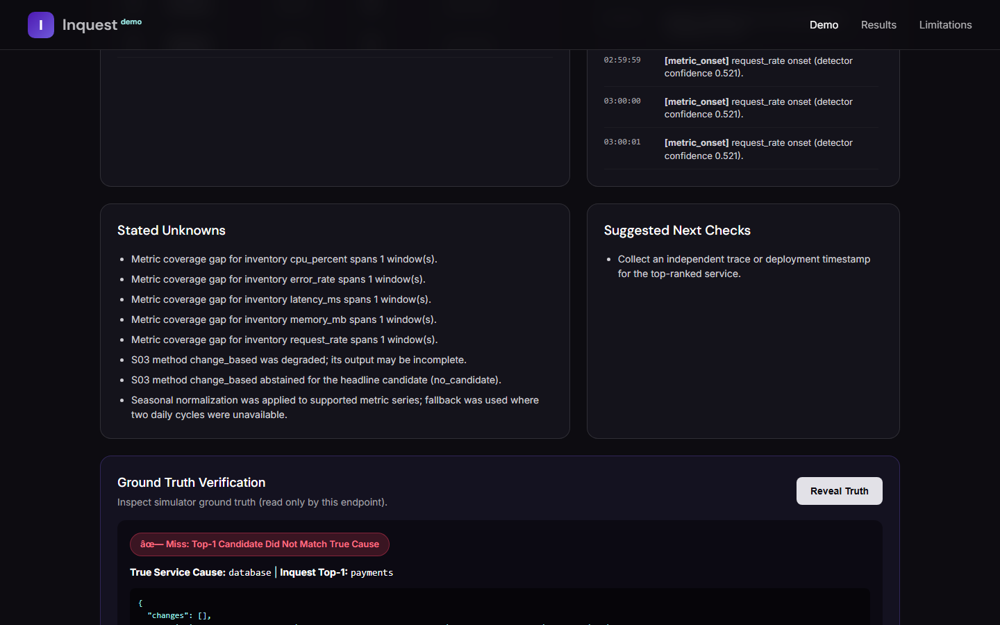
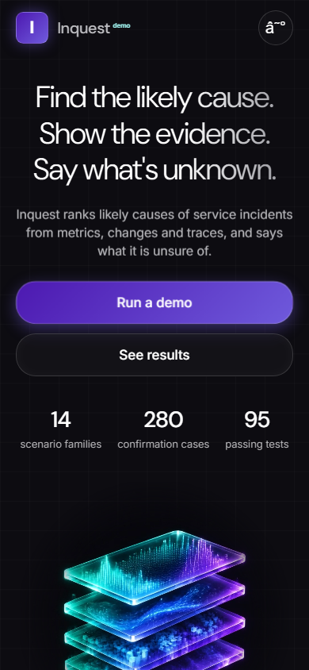

# Inquest (v1.1-demo)

Inquest is an evidence-driven, causal incident investigation system for distributed microservices. It ingests multi-modal observability telemetry (metrics, operational changes, alert logs, dependency graphs, and optional traces), cryptographically binds them into an append-only evidence vault, computes signal onsets, ranks candidate root causes via multi-method fusion, performs heuristic verification, and renders deterministic incident reports citing tamper-evident evidence IDs.

---

## 0. Interactive Web Demo (Local Run in 3 Commands)

Run the full interactive web demo locally:

```bash
# 1. Install editable package and dependencies
pip install -e . && pip install fastapi uvicorn httpx playwright

# 2. Run the interactive web server on port 8000
uvicorn demo.api:app --host 0.0.0.0 --port 8000

# 3. Run the full verification suite (pytest + Playwright E2E)
pytest
```

### Served Web Application Pages

- **`/` — Landing Hero:** Pixel-accurate implementation of the Strata AI design spec (`docs/design/hero_spec.md`) featuring `--u` responsive canvas scaling (2048×1455), self-hosted OFL fonts (DM Sans and Inter), masked artwork video loop, glass cards, and Web Animations timeline. Brand customizable via `?brand=strata`.
- **`/demo` — Interactive Investigation Runner:** Choose scenario family and seed, execute cached (<10ms) or live runs, inspect top 3 candidates with per-method breakdown, rule-based review flags, evidence timelines, unknowns, and click **Reveal Truth** to compare top-1 against simulator ground truth.
- **`/results` — Benchmark Results:** Comprehensive tables across all 948 cases and all 3 seed blocks, highlighting family performance, regressions, and the family-mix baseline caveat.
- **`/limitations` — Operational Boundaries:** Rendered limitations including silent cause failure modes, S04 verification recall, unvalidated confidence models, and real-data status.

### Visual Demo Screenshots

| Desktop Hero (1440×900) | Interactive Demo & Reveal | Mobile Reflow (390×844) |
|:---:|:---:|:---:|
|  |  |  |

---

## 1. Installation

### Prerequisites
- Python 3.11 or 3.12 (Python 3.12.14 recommended).
- Pinned dependencies are listed in `requirements.txt`.

### Setup
On Windows, execute the automated bootstrap script to initialize `.venv` and populate pinned dependencies:

```powershell
.\setup.ps1
```

Verify your installation and environment health using `inquest doctor`:

```powershell
.\.venv\Scripts\python.exe -m inquest.cli doctor
```

`doctor` validates configuration integrity, filesystem paths, plugin registry, candidate and verification method registries, and vault chain integrity.

---

## 2. Quickstart

### 2.1 Ingest a Synthetic Scenario Export
```powershell
# 1. Generate a scenario export (e.g. clean_bad_deploy seed 1)
.\.venv\Scripts\python.exe -m simulator.cli run --scenario clean_bad_deploy --seed 1

# 2. Ingest and run S00–S05 pipeline
.\.venv\Scripts\python.exe -m inquest.cli ingest simulator/exports/scn_373516584288/seed_1/export

# 3. View the rendered markdown report
.\.venv\Scripts\python.exe -m inquest.cli report <run_id>
```

### 2.2 Ingest a Real-World Incident
```powershell
# Ingest an external incident directory formatted per docs/REAL_DATA.md
.\.venv\Scripts\python.exe -m inquest.cli ingest-real path/to/incident_dir/
```

---

## 3. How to Generate Scenarios

The included synthetic simulator generates multi-modal telemetry across 14 failure scenario families:

```powershell
# List available scenario families
.\.venv\Scripts\python.exe -m simulator.cli list

# Generate a specific scenario with a chosen seed
.\.venv\Scripts\python.exe -m simulator.cli run --scenario clean_bad_deploy --seed 1
.\.venv\Scripts\python.exe -m simulator.cli run --scenario red_herring_deploy --seed 42
.\.venv\Scripts\python.exe -m simulator.cli run --scenario silent_cause --seed 72
```

Telemetry is exported to `simulator/exports/<scenario_id>/seed_<seed>/export/`. Exports contain only anonymized, salted identifiers (`scn_<12 hex>`) and raw telemetry without leaking scenario labels or ground truth.

---

## 4. Running the Investigation Pipeline

The pipeline comprises six sequential stages:
- **S00 Ingest (`s00_ingest`):** Normalizes canonical JSON or real incident folders into typed schemas.
- **S01 Vault (`s01_vault`):** Cryptographically seals raw evidence records into a SHA-256 hash-chained ledger (`vault/chain.jsonl`).
- **S02 Signals (`s02_signals`):** Computes metric onset times, service ordering, and coverage gaps using robust biweight/MAD statistics and seasonal decomposition.
- **S03 Candidates (`s03_candidates`):** Evaluates independent root cause localization methods (`change_based`, `graph_rwr`, `trace_ochiai`, `temporal_lag`) and fuses them via V3 score-margin weighted reciprocal-rank fusion.
- **S04 Verification (`s04_verify`):** Enforces vault evidence validity, performs contradiction checks (`dependency_path`, `temporal_consistency`, `recovery_check`, `alternative_check`), and annotates candidates.
- **S05 Report (`s05_report`):** Generates structured JSON (`report.json`) and formatted Markdown (`report.md`) citing verified evidence IDs.

### Pipeline CLI Commands
```powershell
# Validate input without writing run or vault artifacts
.\.venv\Scripts\python.exe -m inquest.cli validate <folder>

# Run pipeline on synthetic/canonical export
.\.venv\Scripts\python.exe -m inquest.cli ingest <export_folder>

# Run pipeline on real incident directory
.\.venv\Scripts\python.exe -m inquest.cli ingest-real <incident_dir>

# Explain stage statuses, timings, and errors
.\.venv\Scripts\python.exe -m inquest.cli explain --run <run_id>

# Rerun a specific stage from saved artifacts
.\.venv\Scripts\python.exe -m inquest.cli rerun --run <run_id> --stage s03_candidates
```

---

## 5. Reading an Incident Report

Incident reports are deterministic and saved under `runs/<run_id>/05_s05_report/`.

Print the report directly to the terminal:
```powershell
.\.venv\Scripts\python.exe -m inquest.cli report <run_id>
```

### Report Sections
1. **Headline:** Identifies the top candidate, assessment confidence flag, and primary rationale.
   - Wording is strictly observational ("Most likely consistent with...").
   - **Rule-Based Assessment Flags:**
     - `standard`: High agreement across methods, complete telemetry, no S04 contradictions (100.0% top-1 accuracy on benchmark evaluation).
     - `review_recommended`: Method disagreement or S04 contradiction flagged (`contested`/`unsupported`). Catches 100% of non-telemetry wrong answers.
     - `insufficient_evidence`: Emitting service has metric coverage gaps or fewer than two methods produced candidates.
2. **Ranked Candidates:** Top 3 candidates with ensemble score, per-method scores, method disagreement, and experimental S04 check status.
3. **Evidence Timeline:** Chronological timeline of metric onsets, deployments, restarts, and alert firings.
4. **Why Not the Runner-Up:** Detailed findings from S04 contradiction checks for the runner-up candidate.
5. **Unknowns & Next Checks:** Disclosed telemetry gaps, degraded methods, or disabled checks, paired with targeted verification steps.
6. **Evidence Citations:** Every assertion carries brackets with exact vault evidence IDs (e.g., `[evidence_ids: metric-db-0, change-dep-1]`).

---

## 6. Reproducing All Results Tables with One Command

Reproduce every benchmark result across all 948 cases (seeds 1–91) and all seed blocks in a single command:

```powershell
.\.venv\Scripts\python.exe eval\reproduce_all_results.py
```

This command renders:
1. Overall 14-family performance table across all 948 cases under the V3 default pipeline.
2. Breakdown by seed block:
   - Development block (seeds 1–51, n=388)
   - Confirmation block (seeds 52–71, n=280)
   - Calibration block (seeds 72–91, n=280)
3. Rule-based flag accuracy and coverage evaluation on seeds 72–91.

Full tabular data and analysis are maintained in `docs/RESULTS.md`. Known limitations and failure modes are documented in `docs/LIMITATIONS.md`.
